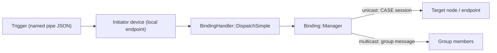

# Testing Binding-Driven Commands in `all-devices-app`

This guide shows how to test, end to end, a device that sends Matter commands to
other devices through the Binding cluster and the
[`BindingHandler`](BindingHandler.h) subsystem. It uses `all-devices-app` on
Linux and `chip-tool`.

The procedure is generic. Section 3 describes each step with placeholders and
explains every parameter, and Sections 4 and 5 apply it to the Doorbell to Chime
pair.

---

## 1. How a Binding Command Flows



Three pieces of configuration must line up for a command to be delivered:

1. **The initiator's binding table** (written with `chip-tool binding write`)
   says _where_ commands from a local endpoint go: a node + endpoint, or a
   group.
2. **The target's Access Control List** (written with
   `chip-tool accesscontrol write acl`) says _who_ is allowed to invoke commands
   on the target cluster.
3. **A trigger** makes the initiator device call
   `BindingHandler::DispatchSimple(...)` for its local endpoint. In the POSIX
   app, triggers are JSON messages written to the named pipe given with
   `--app-pipe`.

---

## 2. Build

```bash
# Build the application
scripts/run_in_build_env.sh "./scripts/build/build_examples.py --target linux-x64-all-devices-clang --quiet build"

# Build chip-tool
scripts/run_in_build_env.sh "./scripts/build/build_examples.py --target linux-x64-chip-tool-clang --quiet build"
```

Binaries:

-   Application: `out/linux-x64-all-devices-clang/all-devices-app`
-   Controller: `out/linux-x64-chip-tool-clang/chip-tool`

The commands below use `$APP` and `$CHIP_TOOL` for these paths:

```bash
APP=./out/linux-x64-all-devices-clang/all-devices-app
CHIP_TOOL=./out/linux-x64-chip-tool-clang/chip-tool
```

---

## 3. Generic Procedure

### Placeholders

| Placeholder      | Meaning                                                                                  |
| ---------------- | ---------------------------------------------------------------------------------------- |
| `<INIT_TYPE>`    | Device type of the initiator (the device that sends commands), e.g. `doorbell`.          |
| `<INIT_EP>`      | Endpoint of the initiator device. Its Binding cluster lives here.                        |
| `<INIT_NODE>`    | Node ID that `chip-tool` assigns to the initiator during commissioning.                  |
| `<TARGET_TYPE>`  | Device type that receives the commands, e.g. `chime`.                                    |
| `<TARGET_EP>`    | Endpoint of the target device that hosts the server cluster.                             |
| `<TARGET_NODE>`  | Node ID that `chip-tool` assigns to the target. Equal to `<INIT_NODE>` on a single node. |
| `<CLUSTER_ID>`   | Decimal ID of the cluster the command belongs to, e.g. `1366` for Chime.                 |
| `<PIPE>`         | Path of the initiator's named pipe, e.g. `/tmp/chip_initiator_fifo`.                     |
| `<TRIGGER_NAME>` | Named-pipe action that makes the initiator send the command, e.g. `ShortPress`.          |
| `112233`         | Node ID of `chip-tool` itself (its default controller node ID).                          |

### Step 1: Clean up old state

```bash
rm -rf /tmp/chip_kvs_initiator /tmp/chip_kvs_target /tmp/chip_initiator_fifo /tmp/chip_target_fifo
```

The KVS files hold the fabric, ACL and binding table from earlier runs. Leftover
state from an earlier run can make commissioning or binding results misleading.

> [!NOTE] If a stale pipe path exists as a regular file (for example, because
> something was written to it before the app created the FIFO), the app cannot
> create the FIFO there. `ls -l <PIPE>` must show a `p` file type.

### Step 2: Start the applications

Each Matter node is one `all-devices-app` process. Start the target first, then
the initiator, in separate terminals:

```bash
# Terminal 1: target node
$APP --device <TARGET_TYPE>:<TARGET_EP> --port 5541 --discriminator 3841 \
     --KVS /tmp/chip_kvs_target --app-pipe /tmp/chip_target_fifo

# Terminal 2: initiator node
$APP --device <INIT_TYPE>:<INIT_EP> --port 5540 --discriminator 3840 \
     --KVS /tmp/chip_kvs_initiator --app-pipe <PIPE>
```

| Option                                 | Meaning                                                                                                                                                                                                                            |
| -------------------------------------- | ---------------------------------------------------------------------------------------------------------------------------------------------------------------------------------------------------------------------------------- |
| `--device <type>[:<ep>][,parent=<ep>]` | Adds a device of `<type>` on endpoint `<ep>` (default `1`). Repeat the option to host several devices on one node. `parent=` nests the endpoint under another one in the Descriptor tree. Run `$APP --help` for the list of types. |
| `--port <port>`                        | UDP port for operational (CASE) traffic. Default `5540`. Each process on the same host needs its own port.                                                                                                                         |
| `--discriminator <0..4095>`            | 12-bit value advertised while the node is commissionable. Default `3840`. Use a different value per process so `chip-tool` can pick the right one.                                                                                 |
| `--passcode <pin>`                     | Setup PIN used for commissioning. Default `20202021`.                                                                                                                                                                              |
| `--KVS <path>`                         | File for persistent storage (fabrics, ACL, bindings). Default `/tmp/chip_kvs`. Use a separate file per process; sharing one file makes the nodes overwrite each other's state.                                                     |
| `--app-pipe <path>`                    | Named pipe (FIFO) the app reads JSON trigger messages from. Only needed on nodes you want to trigger.                                                                                                                              |

### Step 3: Commission both nodes

Commission both nodes onto the same `chip-tool` fabric:

```bash
$CHIP_TOOL pairing onnetwork-long <INIT_NODE> 20202021 3840
$CHIP_TOOL pairing onnetwork-long <TARGET_NODE> 20202021 3841
```

`pairing onnetwork-long <node-id> <setup-pin-code> <discriminator>`:

| Argument           | Meaning                                                                                                                        |
| ------------------ | ------------------------------------------------------------------------------------------------------------------------------ |
| `<node-id>`        | Operational node ID to assign to the device on the `chip-tool` fabric. You choose it; later commands address the node with it. |
| `<setup-pin-code>` | Must match the app's `--passcode` (default `20202021`).                                                                        |
| `<discriminator>`  | Must match the app's `--discriminator`. It selects which commissionable node to pair with.                                     |

> [!TIP] Prefer `onnetwork-long` over `onnetwork` when more than one app is
> running. `pairing onnetwork <node-id> <pin>` pairs with whichever
> commissionable node answers first, so it can assign the node IDs to the wrong
> processes.

Because both nodes are commissioned by the same `chip-tool`, both share its
fabric and both see it as fabric index `1` (it is the first fabric on each
node).

### Step 4 (optional): Check endpoints and clusters

The Descriptor cluster tells you what each endpoint offers. The last two
arguments of every `chip-tool <cluster> read ...` command are
`<destination-node-id> <endpoint-id>`.

```bash
# Initiator: the server list must contain 30 (Binding cluster, 0x001E)
$CHIP_TOOL descriptor read server-list <INIT_NODE> <INIT_EP>
# Initiator: the client list shows which clusters it can send commands to
$CHIP_TOOL descriptor read client-list <INIT_NODE> <INIT_EP>
# Target: the server list must contain <CLUSTER_ID>
$CHIP_TOOL descriptor read server-list <TARGET_NODE> <TARGET_EP>
```

### Step 5: Grant the initiator access on the target

By default, only the administrator (`chip-tool`) may invoke commands on a node.
Add an ACL entry on the target that lets the initiator node invoke commands on
the target cluster:

```bash
$CHIP_TOOL accesscontrol write acl '[
  { "fabricIndex": 1, "privilege": 5, "authMode": 2, "subjects": [112233], "targets": null },
  { "fabricIndex": 1, "privilege": 3, "authMode": 2, "subjects": [<INIT_NODE>],
    "targets": [{ "cluster": <CLUSTER_ID>, "endpoint": <TARGET_EP>, "deviceType": null }] }
]' <TARGET_NODE> 0
```

`accesscontrol write acl <json-list> <destination-node-id> <endpoint-id>`:

| Argument                | Meaning                                                            |
| ----------------------- | ------------------------------------------------------------------ |
| `<json-list>`           | Full list of ACL entries for this fabric (see fields below).       |
| `<destination-node-id>` | Node whose ACL is written: the **target** (`<TARGET_NODE>`).       |
| `<endpoint-id>`         | Always `0`. The Access Control cluster lives on the root endpoint. |

> [!WARNING] The write **replaces** the whole ACL of the fabric. Always keep the
> first entry (Administer privilege for `112233`), or `chip-tool` loses access
> to the node and you have to recommission it.

Fields of each ACL entry:

| Field         | Meaning                                                                                                                                                                                                                 |
| ------------- | ----------------------------------------------------------------------------------------------------------------------------------------------------------------------------------------------------------------------- |
| `fabricIndex` | Fabric the entry belongs to. Required by the JSON format, but the node replaces it with the fabric of the writer, so `1` is fine here.                                                                                  |
| `privilege`   | Highest privilege granted: `1` View, `3` Operate, `4` Manage, `5` Administer. Use the privilege the command requires: most application commands (e.g. Chime `PlayChimeSound`, On/Off `Toggle`) need **Operate**.        |
| `authMode`    | How the subject authenticated: `1` PASE, `2` CASE, `3` Group. Unicast bindings use CASE (`2`).                                                                                                                          |
| `subjects`    | Who the entry applies to. For CASE, a list of node IDs: put the **initiator's** node ID here (and `112233` in the admin entry). For Group auth mode, a list of group IDs. `null` means any subject with that auth mode. |
| `targets`     | What the entry covers. `null` means everything on the node. Otherwise a list of `{cluster, endpoint, deviceType}`; `null` fields are wildcards. `endpoint` and `deviceType` cannot both be set in one target.           |

### Step 6: Write the binding on the initiator

Tell the initiator's endpoint where to send commands:

```bash
$CHIP_TOOL binding write binding '[
  { "fabricIndex": 1, "node": <TARGET_NODE>, "endpoint": <TARGET_EP>, "cluster": <CLUSTER_ID> }
]' <INIT_NODE> <INIT_EP>

# Read it back
$CHIP_TOOL binding read binding <INIT_NODE> <INIT_EP>
```

`binding write binding <json-list> <destination-node-id> <endpoint-id>`:

| Argument                | Meaning                                                                                                                                                                                   |
| ----------------------- | ----------------------------------------------------------------------------------------------------------------------------------------------------------------------------------------- |
| `<json-list>`           | Full list of binding targets for this endpoint and fabric (see fields below).                                                                                                             |
| `<destination-node-id>` | Node whose binding table is written: the **initiator** (`<INIT_NODE>`).                                                                                                                   |
| `<endpoint-id>`         | Endpoint whose Binding cluster is written: `<INIT_EP>`. This must be the endpoint the device dispatches from, because the binding manager only uses entries whose local endpoint matches. |

> [!NOTE] Like the ACL, this write **replaces** all entries of this endpoint for
> the writer's fabric. To bind to several targets, put all of them in one list.

Fields of each binding entry (exactly one of `node` or `group` must be set):

| Field         | Meaning                                                                                                                                                                           |
| ------------- | --------------------------------------------------------------------------------------------------------------------------------------------------------------------------------- |
| `fabricIndex` | Fabric the entry belongs to. Required by the JSON format; the node replaces it with the writer's fabric.                                                                          |
| `node`        | **Unicast**: node ID of the target. The initiator opens a CASE session to this node.                                                                                              |
| `endpoint`    | **Unicast only**: endpoint on the target node that receives the command. Required with `node`, not allowed with `group`.                                                          |
| `group`       | **Multicast**: group ID to send the command to, instead of `node` + `endpoint`. See Section 7.                                                                                    |
| `cluster`     | Optional. Restricts the entry to commands of this cluster. If omitted, the entry is a wildcard and receives commands of **every** cluster the initiator sends from this endpoint. |

### Step 7: Trigger the initiator

Write a JSON message to the initiator's pipe:

```bash
echo '{"Name": "<TRIGGER_NAME>", "EndpointId": <INIT_EP>}' > <PIPE>
```

| Field        | Meaning                                                                                                                                                                          |
| ------------ | -------------------------------------------------------------------------------------------------------------------------------------------------------------------------------- |
| `Name`       | Action to run. It selects a translator registered for the device type (e.g. `ShortPress` for `doorbell`). Unknown names are logged as `NamedPipe::Dispatcher: Unhandled action`. |
| `EndpointId` | Local endpoint of the device to act on: `<INIT_EP>`. Defaults to `0` (root endpoint) if omitted, which has no binding-capable device, so always set it.                          |

The message is parsed on the pipe reader thread and then executed on the Matter
thread, which is where `BindingHandler::DispatchSimple` runs.

### Step 8: Verify

On the **initiator**, a successful unicast command logs:

```text
[SVR] Binding command (0x<cluster>, 0x<command>) succeeded on endpoint <TARGET_EP>
```

The endpoint in this line comes from the target's response, so it is the target
endpoint, not the initiator's.

On the **target**, the interaction model logs an `InvokeRequestMessage` with the
matching `EndpointId`, `ClusterId` and `CommandId`, followed by the device's own
log line for the command.

The first command after startup also sets up the CASE session, so it may take
noticeably longer than the following ones.

---

## 4. Example: Doorbell and Chime on Two Nodes

Values used: `<INIT_TYPE>` = `doorbell`, `<INIT_EP>` = `1`, `<INIT_NODE>` = `1`,
`<TARGET_TYPE>` = `chime`, `<TARGET_EP>` = `1`, `<TARGET_NODE>` = `2`,
`<CLUSTER_ID>` = `1366` (Chime), `<TRIGGER_NAME>` = `ShortPress`.

```text
+---------------------------+                  +-------------------------+
| Node 1: doorbell          |   CASE session   | Node 2: chime           |
|  Endpoint 1               | ===============> |  Endpoint 1             |
|  - Binding (0x001E)       |  PlayChimeSound  |  - Chime (0x0556)       |
+---------------------------+                  +-------------------------+
              ^
              | /tmp/chip_doorbell_fifo  {"Name": "ShortPress", "EndpointId": 1}
```

```bash
# Clean up
rm -rf /tmp/chip_kvs_doorbell /tmp/chip_kvs_chime /tmp/chip_doorbell_fifo /tmp/chip_chime_fifo

# Terminal 1: chime (target)
$APP --device chime:1 --port 5541 --discriminator 3841 \
     --KVS /tmp/chip_kvs_chime --app-pipe /tmp/chip_chime_fifo

# Terminal 2: doorbell (initiator)
$APP --device doorbell:1 --port 5540 --discriminator 3840 \
     --KVS /tmp/chip_kvs_doorbell --app-pipe /tmp/chip_doorbell_fifo

# Terminal 3: controller
$CHIP_TOOL pairing onnetwork-long 1 20202021 3840   # doorbell -> node 1
$CHIP_TOOL pairing onnetwork-long 2 20202021 3841   # chime    -> node 2

# Allow node 1 to invoke Chime commands on node 2, endpoint 1 (Operate privilege)
$CHIP_TOOL accesscontrol write acl '[
  { "fabricIndex": 1, "privilege": 5, "authMode": 2, "subjects": [112233], "targets": null },
  { "fabricIndex": 1, "privilege": 3, "authMode": 2, "subjects": [1],
    "targets": [{ "cluster": 1366, "endpoint": 1, "deviceType": null }] }
]' 2 0

# Bind doorbell endpoint 1 to the Chime cluster on node 2, endpoint 1
$CHIP_TOOL binding write binding '[
  { "fabricIndex": 1, "node": 2, "endpoint": 1, "cluster": 1366 }
]' 1 1

# Press the doorbell
echo '{"Name": "ShortPress", "EndpointId": 1}' > /tmp/chip_doorbell_fifo
```

Expected logs:

-   Doorbell (Terminal 2):
    ```text
    [SVR] Doorbell: Short press on endpoint 1
    [SVR] Binding command (0x556, 0x0) succeeded on endpoint 1
    ```
-   Chime (Terminal 1): an `InvokeRequestMessage` for
    `EndpointId = 0x1, ClusterId = 0x556, CommandId = 0x0`, then:
    ```text
    [SVR] Chime: Playing sound <sound name>
    ```

`ShortPress` also moves the doorbell's Switch `CurrentPosition` to `1` and back
to `0`. You can read it with `$CHIP_TOOL switch read current-position 1 1`.

---

## 5. Example: Doorbell and Chime on One Node

A single process can host both devices on different endpoints. The initiator and
target node are then the same (`<INIT_NODE>` = `<TARGET_NODE>` = `1`), and the
command goes from endpoint 1 to endpoint 2 of that node.

```bash
rm -rf /tmp/chip_kvs_composite /tmp/chip_composite_fifo

$APP --device doorbell:1 --device chime:2 --port 5540 --discriminator 3840 \
     --KVS /tmp/chip_kvs_composite --app-pipe /tmp/chip_composite_fifo

$CHIP_TOOL pairing onnetwork-long 1 20202021 3840

# The subject is the node itself (node 1); the target is the Chime on endpoint 2
$CHIP_TOOL accesscontrol write acl '[
  { "fabricIndex": 1, "privilege": 5, "authMode": 2, "subjects": [112233], "targets": null },
  { "fabricIndex": 1, "privilege": 3, "authMode": 2, "subjects": [1],
    "targets": [{ "cluster": 1366, "endpoint": 2, "deviceType": null }] }
]' 1 0

# Binding on endpoint 1 that points to node 1, endpoint 2
$CHIP_TOOL binding write binding '[
  { "fabricIndex": 1, "node": 1, "endpoint": 2, "cluster": 1366 }
]' 1 1

echo '{"Name": "ShortPress", "EndpointId": 1}' > /tmp/chip_composite_fifo
```

The same process logs the short press on endpoint 1 and then
`Chime: Playing sound ...` for endpoint 2.

---

## 6. Using the Procedure with Another Device

To test a new binding-capable device type, check the following and then follow
Section 3:

1.  **Binding cluster on the endpoint.** The device creates a `BindingCluster`
    on its endpoint with the shared `Binding::Table` and `Binding::Manager` (see
    `Doorbell` or `OnOffLightSwitch`). Step 4 shows `30` in its server list.
2.  **Client clusters declared.** `ClientClusters()` lists the clusters the
    device sends commands to. Step 4 shows them in its client list. This is what
    a controller uses to decide which bindings make sense.
3.  **A dispatch call.** The device receives the application's `BindingHandler`
    in its config and calls
    `bindingHandler.DispatchSimple(endpointId, <Command>::Type{...})` with its
    own endpoint ID, as `Doorbell::TriggerChime` does.
4.  **A trigger.** An OOB accessor and a named-pipe translator map a JSON `Name`
    to that code path (see
    [Out-of-Band Control Architecture](../../docs/design/out_of_band_control.md)).
    Without a trigger, you can still write and read the binding table, but
    nothing is sent.
5.  **A target.** Some device type (in this app or elsewhere) hosts the server
    side of the cluster, and the ACL entry grants the privilege its command
    requires.

---

## 7. Group (Multicast) Bindings

A binding entry with `group` instead of `node` + `endpoint` makes the initiator
send the command as a group message, without a CASE session. A working
end-to-end group test needs more setup than unicast:

-   a group key set and group key map on the initiator (Group Key Management
    cluster), so it can encrypt the message;
-   the same key set on every target, plus group membership on the target
    endpoint (Groups cluster);
-   an ACL entry on each target with `authMode` `3` (Group) and the group ID as
    subject.

None of the target device types in `all-devices-app` currently host a Groups
cluster, so this guide does not cover group bindings end to end. The group
dispatch path is covered by the unit tests in Section 8
(`DispatchToGroupBindingInvokesContextAndReleasesIt` and
`DispatchSimpleCommandToGroupBinding`).

---

## 8. Unit Tests

```bash
# BindingHandler (dispatch, context ownership, group path)
scripts/run_in_build_env.sh "ninja -C out/linux-x64-tests-clang examples/all-devices-app/all-devices-common/binding-handler/tests:TestBindingHandler.run"

# Doorbell device
scripts/run_in_build_env.sh "ninja -C out/linux-x64-tests-clang examples/all-devices-app/all-devices-common/device/types/doorbell/tests:TestDoorbell.run"

# Out-of-band accessors and named-pipe translators (trigger path)
scripts/run_in_build_env.sh "ninja -C out/linux-x64-tests-clang examples/all-devices-app/all-devices-common/oob-accessors/tests:TestOOBAccessors.run"
scripts/run_in_build_env.sh "ninja -C out/linux-x64-tests-clang examples/all-devices-app/posix/named_pipe/tests:TestNamedPipeTranslators.run"
```

Generate the `out/linux-x64-tests-clang` build directory first if it does not
exist:
`scripts/run_in_build_env.sh "./scripts/build/build_examples.py --target linux-x64-tests-clang --quiet gen"`.

---

## 9. Troubleshooting

| Symptom (initiator log unless noted)                                   | Likely cause and fix                                                                                                                                                                                                                                      |
| ---------------------------------------------------------------------- | --------------------------------------------------------------------------------------------------------------------------------------------------------------------------------------------------------------------------------------------------------- |
| Nothing is logged after writing to the pipe; `echo` blocks             | No process is reading the pipe. Start the app with `--app-pipe <PIPE>` and write to the same path.                                                                                                                                                        |
| `NamedPipe::Dispatcher: Unhandled action: <name>`                      | No translator is registered for that `Name`. Check the trigger name for the device type.                                                                                                                                                                  |
| `NamedPipe::Dispatcher: Failed to execute action ... on endpoint <n>`  | Wrong `EndpointId`, or the device on that endpoint does not support the action.                                                                                                                                                                           |
| Short press logged, but no `Binding command ...` line                  | No binding entry matches: the binding was written to another endpoint, its `cluster` differs from the command's cluster, or the table is empty. Check with `binding read binding <INIT_NODE> <INIT_EP>`.                                                  |
| `BindingHandler: Dispatch called before Init`                          | The app did not call `BindingHandler::Init` (or already called `Shutdown`). Check the platform `main`.                                                                                                                                                    |
| `NotifyBoundClusterChanged failed: ...`                                | The binding manager could not start CASE session setup to the target (e.g. unknown fabric, target not reachable). The command stays queued for that binding and is only sent if a session to the target is set up later (for example by a later trigger). |
| `BindingHandler: Peer device connection not ready`                     | The session to the target was not usable when the queued command was delivered. Check that the target is running and reachable, then trigger again.                                                                                                       |
| `Binding command (...) failed: ...` with `UNSUPPORTED_ACCESS` (`0x7E`) | The target rejected the command. Fix the ACL on the target (Step 5): subject must be the initiator's node ID, and privilege must be high enough for the command.                                                                                          |
| Target never logs an `InvokeRequestMessage`                            | Target not running or not reachable, or the binding's `node` / `endpoint` point to the wrong node. Confirm both nodes were commissioned with the expected node IDs.                                                                                       |
| `chip-tool` gets `UNSUPPORTED_ACCESS` after writing an ACL             | The admin entry for `112233` was dropped from the ACL list. Recommission the node after clearing its KVS.                                                                                                                                                 |
